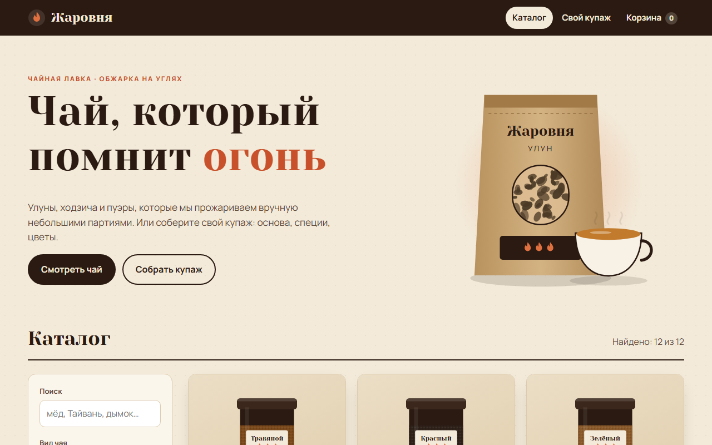

# Жаровня: интернет-магазин чая ручной обжарки

Статический магазин чайной лавки с конструктором купажа: каталог с фильтрами, карточка товара, сборка своей смеси с живой ценой и SVG-превью банки и чашки, корзина и оформление заказа с проверкой полей. Без фреймворков и сборщика, все иллюстрации нарисованы в SVG кодом.


**Демо:** https://whysafe.github.io/chay-lavka/



## Возможности

**Каталог**
- 12 сортов в пяти видах: зелёный, улун, красный, пуэр, травяной
- Фильтры: вид чая (несколько сразу), степень прожарки, ползунок «цена до», поиск по названию, региону и нотам вкуса
- Сортировка: сначала тёмные, дешевле, дороже, по алфавиту; счётчик «найдено N из 12»
- Быстрое добавление в корзину пачки 50 г прямо из карточки

**Карточка товара**
- Крафт-пакет в SVG с окошком, через которое виден лист нужного цвета
- Вес 50 / 100 / 250 г: чем больше упаковка, тем дешевле грамм
- Количество, итоговая сумма на кнопке, параметры заваривания (температура, время, число проливов)
- Блок похожих сортов: тот же вид или та же прожарка

**Конструктор купажа**
- Пять основ и восемь добавок (мята, роза, цедра, корица, имбирь, жасмин, василёк, брусника), не больше четырёх
- Цена за 100 г и итог пересчитываются сразу, жестяная банка опциональна
- Превью: стеклянная банка с основой и частицами добавок своей формы, чашка с цветом настоя, смешанным из оттенков компонентов
- Название на этикетке; одинаковые купажи в корзине складываются в одну позицию

**Корзина и оформление**
- Корзина в `localStorage`, общий счётчик в шапке
- Промокоды `ЖАР10` (−10%) и `ПЕРВЫЙ` (−15%), бесплатная доставка от 3 000 ₽ с подсказкой «осталось N ₽»
- Курьер, Почта России или самовывоз (для самовывоза адрес не спрашивается)
- Проверка имени, мобильного телефона (приводится к виду +7 (9XX) XXX-XX-XX), почты, адреса и согласия; ошибки показываются у полей, фокус переходит на первое неверное
- Адаптивная вёрстка от 360 px, клавиатурная навигация, `prefers-reduced-motion`

## Стек

HTML, CSS (Grid, custom properties), JavaScript ES5 без зависимостей, SVG, шрифты Yeseva One и Manrope из Google Fonts. Тесты на встроенном `node:test`, CI в GitHub Actions.

## Запуск

Можно просто открыть `index.html` в браузере. Или через локальный сервер:

```bash
python -m http.server 8000
```

и открыть http://localhost:8000.

## Как устроено

```
index.html        каркас: шапка, <main id="view">, подвал
css/style.css     палитра в переменных, сетки, адаптив
js/core.js        данные и чистая логика: фильтры, цены, купаж, корзина, валидация
js/art.js         генерация SVG: банка, крафт-пакет, стеклянная банка, чашка
js/app.js         роутер по hash (#/, #/tea/<id>, #/blend, #/cart, #/checkout) и экраны
tests/            юнит-тесты для core.js
```

- `core.js` не трогает DOM и подключается одинаково в браузере (`window.Tea`) и в Node (`module.exports`), поэтому вся бизнес-логика покрыта тестами.
- Частицы в банке раскладывает детерминированный генератор с сидом из состава купажа: при перерисовке картинка не прыгает, а при смене состава меняется.
- Цвет настоя считается взвешенным смешиванием RGB: основа весит 1, каждая добавка 0.18.
- Сайт работает из `file://`: модули не используются, всё подключается обычными `<script>`.

## Тесты

```bash
npm test
```

15 тестов: фильтры и сортировка, цена за вес, расчёт купажа и ограничения на добавки, смешивание цвета, операции с корзиной, промокоды и доставка, нормализация телефона и валидация формы.

## Автор

whysafe · [whysafe.ru](https://whysafe.ru) · Telegram [@yawhysafe](https://t.me/yawhysafe) · канал [@whysafe_official](https://t.me/whysafe_official) · [Kwork](https://kwork.ru/user/whysafe) · hello@whysafe.ru
